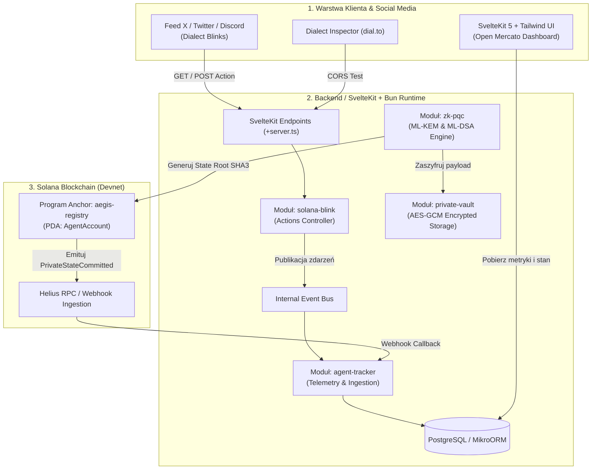

# Plan Wdrożenia: Aegis Mercato 🛡️⚡
> **PQC-Secured Private Agent Observability & Action Engine on Solana**  
> Kompleksowy harmonogram, architektura techniczna, etapy implementacji, testów i wdrożenia na hackathon Solana / AI.  
> **Tech Stack**: **Bun** + **SvelteKit (Svelte 5)** + **Tailwind CSS** + **Anchor (Rust)** + **MikroORM** + **NIST PQC**.

---

## 1. Wstęp i Cele Wdrożenia

**Aegis Mercato** to system integrujący trzy przełomowe technologie w ekosystemie Solana:
1. **Solana Actions & Dialect Blinks** – interakcja z autonomicznymi agentami AI wprost z mediów społecznościowych (X/Twitter, Discord) w modelu *Human-in-the-Loop* (HITL) oraz natychmiastowy *Kill-Switch*.
2. **Obserwowalność i Telemetria (Open Mercato Standard)** – modułowy monolit z Dependency Injection (Awilix), MikroORM (PostgreSQL) i Event Busem śledzącym każdą decyzję i transakcję on-chain agenta.
3. **Kryptografia Post-Kwantowa (PQC) & Zero-Knowledge (ZK)** – ochrona danych i stanów decyzyjnych agenta przed komputerami kwantowymi dzięki standardom NIST: **ML-KEM (Kyber-768)**, **ML-DSA (Dilithium-65)** oraz kotwiczeniu kwantowo-odpornych korzeni stanu (**Quantum-Safe Merkle State Root**) na Solanie.

### Główne cele wdrożenia:
- Powstanie w pełni działającego monorepo napędzanego przez **Bun** oraz **SvelteKit 2 + Svelte 5** (Runes) z **Tailwind CSS**.
- Wdrożenie programu smart kontraktu Anchor na **Solana Devnet**.
- Udostępnienie endpointów Solana Actions zgodnych ze specyfikacją Dialect Blinks (`+server.ts` dla `/api/actions.json` oraz `/api/actions/agent-action`) z możliwością testowania w [dial.to](https://dial.to).
- Działający silnik kryptograficzny PQC z dowodami poprawności i szyfrowaniem wrażliwych stanów agenta.
- Responsywny, nowoczesny Dashboard telemetryczny w SvelteKit + Tailwind CSS do zarządzania agentami.

---

## 2. Architektura Przepływu Danych i Wdrożenia



---

## 3. Matryca Technologiczna i Wymagania

| Warstwa | Technologia / Narzędzie | Wersja | Zastosowanie |
| :--- | :--- | :--- | :--- |
| **Runtime & Package Manager** | **Bun** | 1.1+ | Błyskawiczny menedżer pakietów, runtime TS, zero-overhead execution |
| **Framework Bazowy** | **SvelteKit** (Svelte 5) + TypeScript | SvelteKit 2.x / Svelte 5 (Runes) | Warstwa API Gateway (`+server.ts`), SSR, reaktywność (`$state`) |
| **Styling & UI** | **Tailwind CSS** + Lucide Svelte | v3.4 / v4 | Błyskawiczny styl Cyber-Security / Dark Mode, Glassmorphism, Tailwind utilities |
| **Wzorzec Architektury** | Modular Monolith + Awilix DI | 10.x | Wstrzykiwanie zależności, separacja modułów w `src/lib/server/` |
| **Warstwa Danych** | MikroORM + PostgreSQL | 6.x | Bezpieczne mapowanie encji, migracje bazy zintegrowane w `hooks.server.ts` |
| **Solana Actions** | `@solana/actions` + `@solana/web3.js` | 2.x / 1.95+ | Budowanie Blinków i serializacja transakcji |
| **Smart Kontrakty** | Rust + Anchor Framework | 0.30.x (Solana 1.18+) | Rejestr agentów i kotwiczenie korzeni PQC PDA |
| **Kryptografia PQC** | `@noble/post-quantum` | 0.2.x | Implementacja NIST: ML-KEM-768 oraz ML-DSA-65 |
| **Indeksowanie / RPC** | Helius API / Solana Devnet RPC | - | Nasłuch transakcji, webhooks, sygnatury bloków |
| **Infrastruktura Lokalna** | Docker & Docker Compose | - | Konteneryzacja PostgreSQL i test-validatora |

---

## 4. Analiza Zmiany: Dlaczego Bun + SvelteKit + Tailwind CSS?

1. **Bun zamiast Node.js/npm**:
   - **Prędkość**: Instalacja zależności trwa ułamki sekund (`bun install`), uruchomienie dev-serwera jest natychmiastowe.
   - **Natywny TypeScript**: Brak potrzeby konfiguracji skomplikowanych loaderów (tsx/ts-node) przy skryptach pomocniczych i testach jednostkowych (`bun test`).
2. **SvelteKit (Svelte 5) zamiast Next.js**:
   - **Svelte 5 Runes (`$state`, `$derived`, `$effect`)**: Drastycznie prostsza i czytelniejsza reaktywność w dashboardzie bez problemów z re-renderami Reacta.
   - **Czyste API Endpoints (`+server.ts`)**: W SvelteKit obsługa nagłówków CORS dla Solana Blinks (`OPTIONS`, `GET`, `POST`) jest prosta, w 100% zgodna ze standardem Web Fetch API (`Request` / `Response`), bez niespodzianek z cachingiem i middleware Next.js.
   - **Waga paczki (Bundle Size)**: Svelte kompiluje się do minimalnego kodu JS, co daje błyskawiczne czasy ładowania dashboardu operatora.
3. **Tailwind CSS**:
   - Błyskawiczne tworzenie komponentów z ciemnym motywem (`dark:bg-slate-950`), akcentami neonowymi (`emerald-400`, `violet-500`) i efektami szkła (`backdrop-blur-md bg-white/5 border border-white/10`).

---

## 5. Szczegółowy Harmonogram Wdrożenia (Fazy 0–7)

### Faza 0: Przygotowanie Środowiska i Narzędzi Bazowych (Dzień 1: 0h – 4h)
- [ ] **Weryfikacja środowiska lokalnego**:
  - Instalacja **Bun**: `curl -fsSL https://bun.sh/install | bash`.
  - Instalacja Rust (`rustup default stable`), Solana CLI (`solana-install`) i Anchor CLI (`avm install 0.30.1`).
  - Uruchomienie lokalnego PostgreSQL (przez Docker Compose).
- [ ] **Konfiguracja portfeli Solana**:
  - Wygenerowanie portfela deweloperskiego: `solana-keygen new --outfile ~/.config/solana/id.json`.
  - Przestawienie CLI na Devnet: `solana config set --url https://api.devnet.solana.com`.
  - Airdrop SOL na Devnet (`solana airdrop 2`).
- [ ] **Przygotowanie konfiguracji środowiskowej (`.env`)**:
  - `DATABASE_URL` (Postgres)
  - `SOLANA_RPC_URL` (Helius Devnet RPC URL)
  - `AEGIS_PROGRAM_ID` (uzyskany po kompilacji Anchor)
  - `HELIUS_WEBHOOK_SECRET`
  - `PUBLIC_BASE_URL` (np. URL z ngrok lub domena produkcyjna)

---

### Faza 1: Inicjalizacja Monorepo SvelteKit + Tailwind (Dzień 1: 4h – 8h)
- [ ] **Scaffolding projektu ze SvelteKit i Tailwind CSS**:
  - Inicjalizacja SvelteKit z TypeScript:
    ```bash
    bun create svelte@latest .
    bun install
    bun add -d tailwindcss postcss autoprefixer
    bunx tailwindcss init -p
    ```
  - Instalacja bibliotek pomocniczych:
    ```bash
    bun add @solana/web3.js @solana/actions @noble/post-quantum mikro-orm @mikro-orm/postgresql @mikro-orm/core awilix lucide-svelte
    ```
- [ ] **Konfiguracja struktury modułów w `src/lib/server/`**:
  - `src/lib/server/modules/solana-blink/`
  - `src/lib/server/modules/agent-tracker/`
  - `src/lib/server/modules/zk-pqc/`
  - `src/lib/server/modules/private-vault/`
  - `src/lib/server/di/container.ts` (Awilix DI)
  - `src/lib/server/events/event-bus.ts` (Event Bus)
  - `src/lib/server/db/` (MikroORM)
- [ ] **Inicjalizacja MikroORM w SvelteKit**:
  - Konfiguracja w `src/hooks.server.ts` w celu przekazywania `orm.em.fork()` do requestów.
  - Definicje encji: `Agent.entity.ts`, `AgentActionLog.entity.ts`, `EncryptedDataBlob.entity.ts`.

---

### Faza 2: Smart Kontrakt Solana w Anchor (`programs/aegis-registry`) (Dzień 1: 8h – 16h)
- [ ] **Implementacja programu Anchor**:
  - Konto PDA: `AgentAccount` (seeds = `[b"agent", agent_id]`).
  - Instrukcje:
    - `register_agent(agent_id, pqc_pubkey_hash)`
    - `commit_private_state(new_state_root, zk_proof)`
    - `set_agent_status(is_active)` (Emergency Kill-Switch)
  - Emisja zdarzenia `PrivateStateCommitted`.
- [ ] **Testy i kompilacja**:
  - `anchor build` oraz `anchor test`.
- [ ] **Deployment na Solana Devnet**:
  - `anchor deploy --provider.cluster devnet`.
  - Wyeksportowanie pliku IDL do `src/lib/solana/idl.json`.

---

### Faza 3: Silnik Kryptografii Post-Kwantowej & Private Vault (Dzień 2: 16h – 24h)
- [ ] **Implementacja `PqcCryptoService` (`@noble/post-quantum`)**:
  - Generowanie kluczy **ML-DSA-65 (Dilithium)** i **ML-KEM-768 (Kyber)** w środowisku Bun.
  - Solone committmenty stanów agenta (`computeStateCommitment`) z użyciem algorytmu **SHA3-256**:
    $$\text{Commitment} = \text{SHA3-256}(\text{Salt} \parallel \text{JSON}(\text{State}))$$
  - Podpisywanie hasha stanu przez ML-DSA i weryfikacja poprawności sygnatury.
- [ ] **Implementacja `VaultService` (`src/lib/server/modules/private-vault`)**:
  - Kapsułkowanie klucza sesyjnego AES-256-GCM za pomocą `ml_kem768.encapsulate()`.
  - Szyfrowanie wrażliwych danych decyzyjnych agenta.
  - Trwały zapis metadanych i szyfrogramu w MikroORM (`EncryptedDataBlob`).

---

### Faza 4: Integracja Solana Actions & Dialect Blinks w SvelteKit (Dzień 2: 24h – 32h)
- [ ] **Endpoint reguł routingu i CORS (`src/routes/actions.json/+server.ts` oraz `src/routes/api/actions.json/+server.ts`)**:
  - Implementacja handlera `GET` i `OPTIONS` zwracającego reguły routingu oraz nagłówki:
    - `Access-Control-Allow-Origin: *`
    - `Access-Control-Allow-Methods: GET,POST,PUT,OPTIONS`
    - `Access-Control-Allow-Headers: Content-Type, Authorization, Content-Encoding, Accept-Encoding`
- [ ] **Endpoint metadanych Blinka (`src/routes/api/actions/agent-action/+server.ts`)**:
  - Handler `GET`:
    - Odczyt `agentId` z parametrów zapytania.
    - Zwrócenie struktury `ActionGetResponse` z ikoną tarczy, statusem, skrótem PQC Root oraz przyciskami (Autoryzuj kolejny krok / Kill-Switch).
  - Handler `POST`:
    - Odczyt adresu portfela użytkownika (`account`).
    - Skonstruowanie transakcji Solana wywołującej instrukcję `aegis-registry`.
    - Zwrócenie zserializowanej transakcji w formacie Base64 opakowanej w `createPostResponse`.
  - Handler `OPTIONS`: natychmiastowa odpowiedź 200/204 z nagłówkami CORS.
- [ ] **Weryfikacja w Dialect Inspectorze**:
  - Uruchomienie `bun run dev` + tunel ngrok.
  - Testowanie w [dial.to](https://dial.to).

---

### Faza 5: Obserwowalność, Telemetria & Ingestion (`agent-tracker`) (Dzień 2: 32h – 38h)
- [ ] **Endpoint Webhooka Helius (`src/routes/api/webhooks/helius/+server.ts`)**:
  - Odbieranie powiadomień transakcyjnych on-chain.
  - Weryfikacja sygnatury / secret tokena.
  - Dekodowanie logów Anchor i zdarzenia `PrivateStateCommitted`.
- [ ] **Przetwarzanie w Event Bus**:
  - Publikowanie zdarzenia `AgentStateCommitted` lub `AgentKilled`.
  - Aktualizacja encji `Agent` i dopisanie wpisu w `AgentActionLog`.

---

### Faza 6: Dashboard Operatora w Svelte 5 + Tailwind (Dzień 3: 38h – 44h)
- [ ] **Widok główny (`src/routes/(dashboard)/+page.svelte`)**:
  - Reaktywne zarządzanie stanem za pomocą Runes:
    ```svelte
    <script lang="ts">
      let agents = $state([]);
      let selectedAgent = $state(null);
    </script>
    ```
  - **Karty statusu agentów**: Stylizowane za pomocą Tailwind CSS z gradientami (`from-slate-900 via-purple-950 to-slate-900`) i obramowaniami z podświetleniem.
  - **PQC & ZK Inspector**: Wizualizacja 32-bajtowego korzenia stanu (Quantum-Safe Merkle State Root) i hasha klucza ML-DSA.
  - **Blink Sharing Hub**: Generator linków do Dialect Blinks z przyciskiem kopiowania i podglądem w dial.to.
  - **Emergency Kill-Switch**: Błyskawiczny przycisk wstrzymania agenta z animacją ostrzegawczą.

---

### Faza 7: Testy E2E, Deployment i Przygotowanie Demo (Dzień 3: 44h – 48h)
- [ ] **Pełny test scenariusza demonstracyjnego**:
  1. Agent podejmuje autonomiczną decyzję -> szyfrowanie ML-KEM + podpis ML-DSA.
  2. Publikacja linku Blinka -> operator klika "Autoryzuj kolejny krok" w dial.to.
  3. Transakcja ląduje na Solana Devnet -> Anchor aktualizuje konto PDA.
  4. Webhook Helius wyłapuje zdarzenie -> Dashboard w SvelteKit automatycznie aktualizuje stan w czasie rzeczywistym.
- [ ] **Wdrożenie chmurowe**:
  - Wdrożenie aplikacji SvelteKit na Vercel / Railway / Cloudflare Pages przy użyciu `@sveltejs/adapter-auto` lub `@sveltejs/adapter-node` z Bun.
  - Baza PostgreSQL na Supabase / Neon / Railway.
- [ ] **Przygotowanie Pitch Decku i wideo**:
  - Prezentacja dla sędziów pokazująca integrację Bun + SvelteKit + Solana Blinks + NIST PQC.

---

## 6. Komendy Wykonawcze z Użyciem Bun

```bash
# 1. Start bazy danych w tle
docker compose up -d postgres

# 2. Instalacja zależności przez Bun (ultraszybko)
bun install

# 3. Kompilacja i test kontraktu Anchor
cd programs/aegis-registry
anchor build
anchor test
cd ../..

# 4. Uruchomienie deweloperskie SvelteKit
bun run dev

# 5. Uruchomienie testów kryptograficznych PQC
bun test
```

---

## 7. Kryteria Gotowości (Definition of Done)

- [ ] Aplikacja i skrypty w całości zarządzane i uruchamiane przez **Bun**.
- [ ] Interfejs użytkownika zbudowany w **SvelteKit 2 + Svelte 5 (Runes)** i ostylowany w **Tailwind CSS**.
- [ ] Endpointy Blinks (`+server.ts`) w pełni zgodne ze specyfikacją Dialect Actions i zweryfikowane na [dial.to](https://dial.to).
- [ ] Smart kontrakt `aegis-registry` wdrożony na Solana Devnet.
- [ ] Moduł `@noble/post-quantum` szyfruje stany i generuje podpisy ML-DSA.
- [ ] Dashboard operatora wizualizuje telemetrię i tarcze kwantowe w czasie rzeczywistym.
