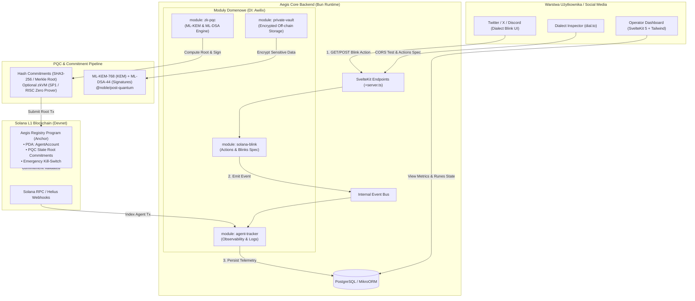

# Aegis Mercato: Architektura Systemu (Hackathon)

> **PQC-Secured Private Agent Observability & Action Engine on Solana**  
> Zbudowane w oparciu o wzorzec **Modular Monolith** w standardzie Open Mercato (Awilix IoC, Bun, SvelteKit 2 z Svelte 5 Runes, Tailwind CSS, MikroORM).

---

## 1. Executive Summary & Założenia Projektowe

### Wizja
Stworzenie platformy nowej generacji łączącej:
- **Autonomicznych agentów AI na Solanie** z pełną obserwowalnością i audytowalnością.
- **Interakcję z użytkownikiem w mediach społecznościowych** za pomocą protokołu **Solana Actions & Dialect Blinks** (Human-in-the-Loop bezpośrednio z Twittera/X, Discorda oraz Dialect Inspectora `dial.to`).
- **Bezpieczeństwo post-kwantowe (PQC)** i **prywatność stanów (Zero-Knowledge Commitments)**: Ochrona wrażliwych danych agentów (strategie, klucze API, salda) przed złamaniem przez komputery kwantowe poprzez wykorzystanie algorytmów NIST PQC (ML-DSA-44 / Dilithium, ML-KEM-768 / Kyber) oraz kotwiczenie kwantowo-odpornych korzeni stanu (**Quantum-Safe Merkle State Root**) na Solanie w koncie PDA programu Anchor.

---

## 2. Architektura Systemu



---

## 3. Struktura Katalogów Projektu (SvelteKit + Bun Standard)

```text
solana-aegis-mercato/
├── AGENTS.md                          # Instrukcje architektury dla agentów AI
├── package.json                       # Konfiguracja projektu zarządzana przez Bun
├── tsconfig.json
├── svelte.config.js                   # Konfiguracja SvelteKit 2
├── vite.config.ts                     # Vite bundler
├── tailwind.config.ts                 # Konfiguracja Tailwind CSS
├── docker-compose.yml                 # PostgreSQL, Redis, local Solana test-validator
├── programs/                          # Smart Kontrakty Solana (Anchor)
│   └── aegis-registry/
│       ├── Cargo.toml
│       ├── Anchor.toml
│       └── src/
│           ├── lib.rs                 # Główna logika programu Anchor
│           ├── state.rs               # Definicje kont PDA (AgentAccount)
│           ├── errors.rs              # Kody błędów (np. AgentInactive)
│           └── instructions/
│               ├── register_agent.rs
│               ├── commit_private_state.rs
│               └── set_agent_status.rs
├── zk-circuits/                       # Obwody dowodzące zkVM (Opcjonalny SP1 Prover / STARK)
│   ├── Cargo.toml
│   └── src/
│       └── main.rs                    # Obwód weryfikujący stan i sygnaturę ML-DSA
└── src/
    ├── routes/                        # SvelteKit App Router
    │   ├── actions.json/
    │   │   └── +server.ts             # Główny routing Actions (standard Dialect Blinks)
    │   ├── (dashboard)/
    │   │   ├── +page.svelte           # Dashboard operatora w Svelte 5 (Runes)
    │   │   └── +page.server.ts        # Ładowanie danych agentów i telemetrii
    │   └── api/
    │       ├── actions/
    │       │   ├── actions.json/
    │       │   │   └── +server.ts     # Alternatywny fallback dla actions.json
    │       │   └── agent-action/
    │       │       └── +server.ts     # GET (metadane Blinka) & POST (budowanie transakcji)
    │       └── webhooks/
    │           └── helius/
    │               └── +server.ts     # Ingestion transakcji on-chain z Helius
    ├── lib/
    │   ├── server/
    │   │   ├── modules/               # Moduły Domenowe (Modular Monolith)
    │   │   │   ├── solana-blink/
    │   │   │   │   ├── services/
    │   │   │   │   │   └── blink-generator.service.ts
    │   │   │   │   └── controllers/
    │   │   │   │       └── blink.controller.ts
    │   │   │   ├── agent-tracker/
    │   │   │   │   ├── entities/
    │   │   │   │   │   ├── Agent.entity.ts
    │   │   │   │   │   └── AgentActionLog.entity.ts
    │   │   │   │   ├── services/
    │   │   │   │   │   ├── telemetry.service.ts
    │   │   │   │   │   └── onchain-watcher.service.ts
    │   │   │   │   └── subscribers/
    │   │   │   │       └── agent-events.subscriber.ts
    │   │   │   ├── zk-pqc/
    │   │   │   │   ├── services/
    │   │   │   │   │   ├── pqc-crypto.service.ts    # ML-KEM & ML-DSA (@noble/post-quantum)
    │   │   │   │   │   ├── zk-prover.service.ts     # Wrapper Provera dowodów
    │   │   │   │   │   └── state-merkle.service.ts  # Kwantowo-odporne drzewo Merkle
    │   │   │   ├── private-vault/
    │   │   │   │   ├── services/
    │   │   │   │   │   └── vault.service.ts         # Hybrydowe szyfrowanie off-chain
    │   │   │   │   └── entities/
    │   │   │   │       └── EncryptedDataBlob.entity.ts
    │   │   ├── di/
    │   │   │   └── container.ts       # Awilix IoC Container
    │   │   ├── events/
    │   │   │   └── event-bus.ts       # Wewnętrzny Event Bus
    │   │   └── db/
    │   │       └── mikro-orm.config.ts# Konfiguracja MikroORM PostgreSQL
    │   └── solana/
    │       └── idl.json               # Wygenerowany IDL programu Anchor
    └── hooks.server.ts                # Inicjalizacja MikroORM & DI na żądanie
```

---

## 4. Specyfikacja Techniczna Modułów

### 4.1. Moduł: `solana-blink` (Solana Actions)
Odpowiada za standard **Dialect Blinks** / **Solana Actions**:
- `GET /actions.json` i `GET /api/actions.json` – deklaracja reguł routingu actions (CORS & Actions Spec).
- `GET /api/actions/agent-action?agentId=...` – zwraca metadane akcji do wyrenderowania w feedzie na Twitterze/X oraz dial.to (ikona, opis stanu, przyciski autoryzacji akcji agenta, kill-switch).
- `POST /api/actions/agent-action` – odbiera konto portfela użytkownika (`account`), przygotowuje i podpisuje transakcję Solana kierowaną do programu `aegis-registry`, zwracając zserializowaną transakcję w formacie base64.

### 4.2. Moduł: `agent-tracker` (Obserwowalność i Telemetria)
- Pobiera zdarzenia on-chain (za pośrednictwem webhooków Helius lub dedykowanego serwisu indeksującego RPC).
- Mapuje akcje agentów (zakupy, swapy, rebalansowanie, wywołania AI) do encji w bazie PostgreSQL (MikroORM).
- Publikuje zdarzenia w **Event Bus** (`AgentActionTriggered`, `AgentActionValidated`, `AgentKilled`).

### 4.3. Moduł: `zk-pqc` oraz `private-vault` (Post-Quantum ZK Commitments & DMS)
> Nieaktualne: DMS, `aegis-registry`, commitmenty SHA3-256, korzeń Merkle i ML-KEM-768 nie są zaimplementowane; dla dowodu DMS nie istnieje weryfikator na Solanie. Obowiązuje [decyzja 004](decisions/004-bez-dms-ochrona-pq-bez-dowodu-seeda.md).

- **Problem kryptograficzny**: Klasyczne algorytmy asymetryczne (RSA, ECC, Ed25519) są podatne na złamanie przez algorytm Shora na komputerach kwantowych. W łańcuchach typu ECDSA (Ethereum, Bitcoin) ujawnienie klucza publicznego trwale kompromituje konto, ponieważ klucze są bezstrukturalnymi skalarami.
- **Przewaga strukturalna Solany (RFC 8032 & SLIP-0010)**:
  - Zgodnie z badaniami *Baldimtsi et al. (FC 2026, Mysten Labs & Soundness Labs)*: łańcuchy oparte na **EdDSA (Solana)** posiadają kluczową cechę – klucz prywatny jest deterministycznie wyprowadzany z **256-bitowego seeda** poprzez funkcję skrótu:
    $$\text{sk} = \text{HashToScalar}(\text{SHA-512}(\text{seed})[:32]), \quad \text{pk} = \text{sk} \cdot G$$
  - Nawet jeśli komputer kwantowy odzyska $\text{sk}$ ze znanego $\text{pk}$, **nie potrafi odwrócić SHA-512** (atak Grovera daje jedynie przyspieszenie $\mathcal{O}(\sqrt{N})$, zachowując ~256 bitów bezpieczeństwa).
  - Prawdziwy właściciel konta zna $\text{seed}$, co pozwala na autoryzację przejścia w tryb post-kwantowy bez utraty konta i bez zmiany adresu on-chain!

- **Model Dual-Mode Signature (DMS) & One-Time Attestation w Aegis**:
  1. **Dual Mode Signature (DMS)**:
     - **Mode 1 (Legacy)**: Standardowy podpis Ed25519 używany w normalnym cyklu życia Solany.
     - **Mode 2 (Quantum-Safe)**: Podpisy **ML-DSA-44 (Dilithium)** wspierane przez kapsułkowanie **ML-KEM-768 (Kyber)**.
  2. **One-Time Key Certification (Atestacja powiązania)**:
     - Zamiast generować ogromny dowód ZK (~5.4 MB w zkVM) do każdej transakcji, agent dokonuje **jednorazowej certyfikacji** powiązania: rejestruje hash swojego klucza post-kwantowego `pqc_pubkey_hash` w koncie PDA programu `aegis-registry`.
     - Kolejne decyzje, logi i akcje agenta autoryzowane są przez podpis ML-DSA weryfikowany względem zarejestrowanego stanu.
  3. **Kwantowo-odporne Commitments**:
     - Wykorzystanie solonych hashy (**Hash-based Commitments**: SHA3-256):
       $$\text{CommitmentRoot} = \text{SHA3-256}(\text{Salt} \parallel \text{JSON}(\text{DecisionPayload}))$$
     - Kotwiczenie wyłącznie 32-bajtowego korzenia stanu (**Quantum-Safe Merkle State Root**) na L1 Solany w PDA agenta.
     - Pełna agilność kryptograficzna (*Crypto Agility*) – możliwość rotacji parametrów PQC bez naruszania struktury bazowej konta Solana.

---

## 5. Implementacje Kluczowych Komponentów

### 5.1. Serwis PQC & Commitments (`src/lib/server/modules/zk-pqc/services/pqc-crypto.service.ts`)
```typescript
import { ml_dsa44 } from '@noble/post-quantum/ml-dsa';
import { ml_kem768 } from '@noble/post-quantum/ml-kem';
import { createHash, randomBytes } from 'crypto';

export interface PqcKeyPair {
  publicKey: Uint8Array;
  secretKey: Uint8Array;
}

export class PqcCryptoService {
  /**
   * Generuje parę kluczy ML-DSA-44 (Dilithium) dla agenta
   */
  generateDsaKeys(): PqcKeyPair {
    const keys = ml_dsa44.keygen();
    return {
      publicKey: keys.publicKey,
      secretKey: keys.secretKey,
    };
  }

  /**
   * Generuje parę kluczy ML-KEM-768 (Kyber) do szyfrowania danych niepublicznych
   */
  generateKemKeys(): PqcKeyPair {
    const keys = ml_kem768.keygen();
    return {
      publicKey: keys.publicKey,
      secretKey: keys.secretKey,
    };
  }

  /**
   * Oblicza post-kwantowy commitment stanu z użyciem solenia (SHA3-256 / Poseidon)
   */
  computeStateCommitment(privatePayload: Record<string, unknown>): { commitmentRoot: Buffer; salt: Buffer } {
    const salt = randomBytes(32);
    const serialized = Buffer.from(JSON.stringify(privatePayload), 'utf-8');
    
    const hasher = createHash('sha3-256');
    hasher.update(salt);
    hasher.update(serialized);
    const commitmentRoot = hasher.digest();

    return { commitmentRoot, salt };
  }

  /**
   * Podpisuje stan agenta przy użyciu post-kwantowego podpisu ML-DSA
   */
  signState(stateHash: Uint8Array, secretKey: Uint8Array): Uint8Array {
    return ml_dsa44.sign(secretKey, stateHash);
  }

  /**
   * Weryfikuje podpis ML-DSA
   */
  verifyStateSignature(stateHash: Uint8Array, signature: Uint8Array, publicKey: Uint8Array): boolean {
    return ml_dsa44.verify(publicKey, stateHash, signature);
  }
}
```

### 5.2. Kontroler Solana Actions & Blinks (`src/lib/server/modules/solana-blink/controllers/blink.controller.ts`)
```typescript
import { ActionGetResponse, ActionPostRequest, ActionPostResponse, createPostResponse } from '@solana/actions';
import { PublicKey, Transaction, TransactionInstruction } from '@solana/web3.js';

export class BlinkController {
  constructor(
    private readonly telemetryService: any,
    private readonly solanaConnection: any
  ) {}

  async getActionMetadata(agentId: string): Promise<ActionGetResponse> {
    const agent = await this.telemetryService.getAgentStatus(agentId);
    
    return {
      type: 'action',
      icon: 'https://aegis-mercato.app/icons/pqc-shield.png',
      title: `Aegis Sentinel | Agent: ${agent.name}`,
      description: `Stan: ${agent.status} | Aktywne zadanie: ${agent.currentTask}\nPQC State Root: ${agent.lastCommitment.slice(0, 14)}...`,
      label: 'Autoryzacja Agenta',
      actions: [
        {
          label: 'Autoryzuj kolejny krok',
          href: `/api/actions/agent-action?agentId=${agentId}&decision=approve`
        },
        {
          label: 'Emergency Kill-Switch (Wstrzymaj)',
          href: `/api/actions/agent-action?agentId=${agentId}&decision=pause`
        }
      ]
    };
  }

  async createActionTransaction(req: ActionPostRequest, agentId: string, decision: string): Promise<ActionPostResponse> {
    const userPubkey = new PublicKey(req.account);
    const tx = new Transaction();

    const programId = new PublicKey(process.env.AEGIS_PROGRAM_ID!);
    
    // Instrukcja wzywająca smart kontrakt na Solanie
    const instruction = new TransactionInstruction({
      keys: [
        { pubkey: userPubkey, isSigner: true, isWritable: true },
      ],
      programId,
      data: Buffer.from(JSON.stringify({ agentId, decision }))
    });

    tx.add(instruction);
    tx.feePayer = userPubkey;
    const { blockhash } = await this.solanaConnection.getLatestBlockhash();
    tx.recentBlockhash = blockhash;

    return await createPostResponse({
      fields: {
        transaction: tx,
        message: `Agent ${agentId} został zaktualizowany decyzją: ${decision.toUpperCase()}.`
      }
    });
  }
}
```

### 5.3. Smart Kontrakt Solana (Anchor: `programs/aegis-registry/src/lib.rs`)
```rust
use anchor_lang::prelude::*;

declare_id!("Aeg1sRegistry11111111111111111111111111111111");

#[program]
pub mod aegis_registry {
    use super::*;

    pub fn register_agent(
        ctx: Context<RegisterAgent>,
        agent_id: String,
        pqc_pubkey_hash: [u8; 32]
    ) -> Result<()> {
        let agent = &mut ctx.accounts.agent_account;
        agent.owner = *ctx.accounts.owner.key;
        agent.agent_id = agent_id;
        agent.pqc_pubkey_hash = pqc_pubkey_hash;
        agent.is_active = true;
        agent.last_state_root = [0u8; 32];
        agent.last_updated = Clock::get()?.unix_timestamp;
        Ok(())
    }

    pub fn commit_private_state(
        ctx: Context<CommitPrivateState>,
        new_state_root: [u8; 32],
        _zk_proof: Vec<u8>
    ) -> Result<()> {
        let agent = &mut ctx.accounts.agent_account;
        require!(agent.is_active, AegisError::AgentInactive);
        
        // Zapis odpornego na ataki kwantowe korzenia stanu niepublicznego
        agent.last_state_root = new_state_root;
        agent.last_updated = Clock::get()?.unix_timestamp;

        emit!(PrivateStateCommitted {
            agent_id: agent.agent_id.clone(),
            state_root: new_state_root,
            timestamp: agent.last_updated,
        });

        Ok(())
    }

    pub fn set_agent_status(
        ctx: Context<SetAgentStatus>,
        is_active: bool
    ) -> Result<()> {
        let agent = &mut ctx.accounts.agent_account;
        agent.is_active = is_active;
        agent.last_updated = Clock::get()?.unix_timestamp;
        Ok(())
    }
}

#[account]
pub struct AgentAccount {
    pub owner: Pubkey,
    pub agent_id: String,
    pub pqc_pubkey_hash: [u8; 32],
    pub last_state_root: [u8; 32],
    pub is_active: bool,
    pub last_updated: i64,
}

#[derive(Accounts)]
#[instruction(agent_id: String)]
pub struct RegisterAgent<'info> {
    #[account(
        init,
        payer = owner,
        space = 8 + 32 + 64 + 32 + 32 + 1 + 8,
        seeds = [b"agent", agent_id.as_bytes()],
        bump
    )]
    pub agent_account: Account<'info, AgentAccount>,
    #[account(mut)]
    pub owner: Signer<'info>,
    pub system_program: Program<'info, System>,
}

#[derive(Accounts)]
pub struct CommitPrivateState<'info> {
    #[account(mut, has_one = owner)]
    pub agent_account: Account<'info, AgentAccount>,
    pub owner: Signer<'info>,
}

#[derive(Accounts)]
pub struct SetAgentStatus<'info> {
    #[account(mut, has_one = owner)]
    pub agent_account: Account<'info, AgentAccount>,
    pub owner: Signer<'info>,
}

#[event]
pub struct PrivateStateCommitted {
    pub agent_id: String,
    pub state_root: [u8; 32],
    pub timestamp: i64,
}

#[error_code]
pub enum AegisError {
    #[msg("Agent jest obecnie wstrzymany")]
    AgentInactive,
}
```

---

## 6. Harmonogram Realizacji na Hackathon (36–48h)

| Okres | Cel | Kluczowe Rezultaty |
| :--- | :--- | :--- |
| **0h – 6h** | **Infrastruktura & Środowisko** | Inicjalizacja Open Mercato monorepo, setup Postgres/MikroORM, konfiguracja Solana Devnet i Anchor CLI. |
| **6h – 16h** | **Solana Blink & Kontrakt Anchor** | Kompilacja i wdrożenie `aegis-registry` na Solana Devnet. Oprogramowanie endpointów Solana Actions (`actions.json` + `agent-action`), test w Dialect Inspectorze (`dial.to`). |
| **16h – 26h** | **Agent Tracking & Observability** | Integracja Event Busa Open Mercato, nasłuch transakcji z Helius Webhook, zapis historii akcji w MikroORM, widok w dashboardzie SvelteKit 5. |
| **26h – 38h** | **PQC & ZK State Pipeline** | Integracja `@noble/post-quantum` (ML-DSA / ML-KEM). Generowanie solonych commitmentów SHA3/Poseidon dla danych prywatnych, generowanie dowodu i zapisywanie rootów on-chain. |
| **38h – 48h** | **Testy E2E, Polishing & Demo** | Przejście pełnego scenariusza live: akcja agenta -> Blink na Twitterze -> podpis transakcji -> zapis PQC Roota na Solanie -> aktualizacja stanu w dashboardzie. |

---

## 7. Wskazówki i "Pitch Deck" dla Jury

1. **Dlaczego Open Mercato?** Pokazuje dojrzałość inżynierską – zamiast prototypu w jednym pliku, stworzono modularną, skalowalną platformę z Dependency Injection (Awilix) i Event-Driven Architecture.
2. **Dlaczego PQC + Dual-Mode Signature (DMS)?**
   > Nieaktualne: DMS nie jest zaimplementowany i na Solanie nie istnieje weryfikator jego dowodu. Obowiązuje [decyzja 004](decisions/004-bez-dms-ochrona-pq-bez-dowodu-seeda.md).
   - Komputery kwantowe (algorytm Shora) nieodwracalnie łamią ECDSA (Ethereum/Bitcoin), niszcząc tożsamość kont.
   - Wskazujemy na **przełomową przewagę Solany (RFC 8032 / SLIP-0010)** udowodnioną w pracy *Baldimtsi et al. (FC 2026)*: klucz Solany to w istocie seed za hashem SHA-512, którego komputer kwantowy nie potrafi odwrócić.
   - Aegis Mercato jako pierwsze rozwiązanie na Solanie wdraża formalny model **Dual-Mode Signatures (DMS)** i jednorazową atestację klucza **ML-DSA-44 (NIST PQC)**, pozwalając agentom na bezpieczną migrację post-kwantową bez konieczności porzucania adresów portfeli.
3. **Efekt "WOW" na żywo**: Bezpośrednia interakcja z agentem AI na Twitterze/X za pośrednictwem Blinka (Human-in-the-Loop i awaryjny Kill-Switch), bez konieczności opuszczania platformy społecznościowej.
