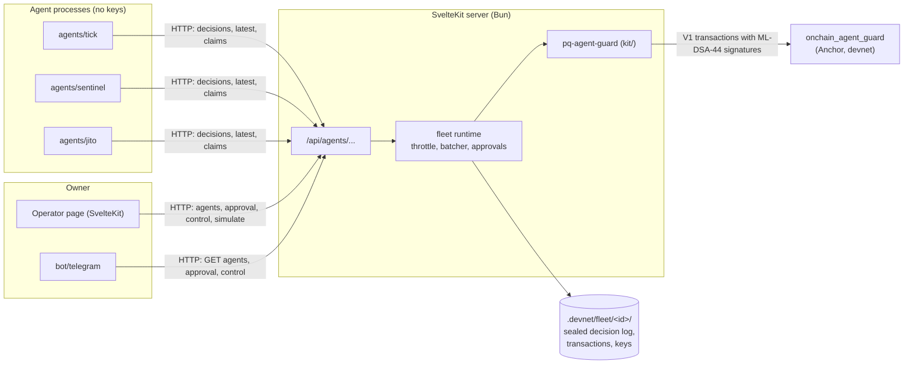

# Oberek: architecture

Oberek guards AI agents on Solana with post-quantum signatures. Each step an agent takes is signed with its own
ML-DSA-44 key, verified on-chain by the `onchain_agent_guard` program and recorded there. The owner can kill the agent
at any time; a resume needs the agent's ML-DSA-44 signature as well. The mechanism is a layer for any agent, and the
agents in this repo are demos of it ([decision 003](decisions/003-ochrona-pq-dla-dowolnego-agenta.md)).

How to run it: [README.md](../README.md). Which key signs what: [keys.md](keys.md). How an agent's history is audited:
[history-audit.md](history-audit.md).

## 1. Components



- **Program** (`onchain/`): holds each agent's prepared ML-DSA-44 key, its status, step counter and last decision hash.
  It is the only gate that matters: a step without a valid signature never lands, whoever sends it
  ([decision 002](decisions/002-podpis-pq-ml-dsa-44.md)).
- **Kit** (`kit/`, package `pq-agent-guard`): the program's client and a guard built on it. It does not import anything
  from the app.
- **Server** (`src/`): runs the fleet. It holds the agents' ML-DSA-44 secret keys, the owner's wallet and the fee payer,
  signs and sends every step, and keeps each agent's decision log sealed on disk. It serves the operator page and the
  HTTP API.
- **Agents** (`agents/`): separate processes that decide what to do and submit decisions over HTTP. They hold no keys
  and know nothing about Solana.
- **Telegram bot** (`bot/telegram`): a separate process that polls the API and gives the owner Accept, Reject, Kill
  and Resume buttons ([decision 008](decisions/008-wlasciciel-przez-telegram.md)).

There is no database. State lives on chain and in files under `.devnet/` (gitignored), and the demo stores (armed
shocks and proposals, quiet-cycle counts, picked pace) live in server memory.

## 2. Repository layout

```text
.
├── onchain/                         Anchor workspace
│   ├── programs/onchain_agent_guard/src/
│   │   ├── lib.rs                   instructions and account constraints
│   │   ├── state.rs                 accounts and events
│   │   ├── message.rs               the messages the ML-DSA-44 signatures cover
│   │   └── error.rs                 GuardError
│   ├── run-tests.sh                 Mollusk tests (Docker)
│   └── deploy-devnet.sh
├── kit/                             pq-agent-guard: client, OnchainGuard, openGuardedAgent / step
├── src/
│   ├── routes/
│   │   ├── +page.svelte, +page.server.ts   operator page
│   │   └── api/agents/...           HTTP API (section 5)
│   └── lib/
│       ├── components/              ApprovalPanel, DecisionFeed, ProposalSim
│       └── server/modules/
│           ├── fleet/               runtime, decision path, batching, approvals, control, sealed log, audit
│           ├── solana-blink/        blink.service.ts: agent cards and owner actions for the routes (old name)
│           └── agent/               config from .env and the standalone step loop of `scripts/agent.ts run`
├── agents/
│   ├── shared/                      HTTP client of the API, loop, env
│   ├── tick/                        one heartbeat step per cycle
│   ├── sentinel/                    virtual SOL/USDC treasury rebalancer, large rebalances need approval
│   └── jito/                        JitoSOL steward, simulated governance votes
├── bot/telegram/                    owner bot
├── scripts/                         setup, demo, agent and fleet CLIs, audit, devnet e2e
├── e2e/                             Playwright tests of the operator page on devnet, with their own fleet
├── spikes/                          compatibility spikes (ML-DSA, Falcon, Anchor verify, wallet V1)
├── spec/                            this file, keys, history audit, decisions
└── docs/                            plans, research, prompts, archived work
```

## 3. On-chain program: `onchain_agent_guard`

Deployed on devnet at `BL6Fjh4pADgjvZwaueeAcc7rYddFrdMNWnqK73x78ZSs`, still upgradeable. Signatures are verified
with `solana-ml-dsa` against keys prepared once at registration. Preparing a key costs about 1.09 M CU, and a
verification about 0.26 M CU.

### Accounts

| Account | Address | Holds |
| :--- | :--- | :--- |
| `AgentKey` | client-created (> 10 KiB, CPI can't create it) | the agent's prepared ML-DSA-44 key |
| `Agent` | PDA `["agent", owner, agent_key]` | `owner`, `agent_key`, `status` (`Pending` / `Active` / `Killed`), `counter`, `last_decision` |
| `OwnerKey` | client-created | the owner's prepared ML-DSA-44 key |
| `OwnerRecord` | PDA `["owner", owner]` | `owner`, `owner_key`; created with `init`, so one key per wallet, forever |

### Instructions

| Instruction | Signed by | Effect |
| :--- | :--- | :--- |
| `register_owner(public_key)` | owner wallet (Ed25519) | prepares the owner's key and creates `OwnerRecord` |
| `register_agent(public_key)` | owner wallet (Ed25519) | prepares the agent's key and creates `Agent` as `Pending` |
| `activate_agent(signature)` | owner ML-DSA-44 | `Pending` → `Active` ([decision 005](decisions/005-klucz-pq-wlasciciela-aktywuje-agenta.md)) |
| `record_step(decision_hash, signature)` | agent ML-DSA-44 | `counter + 1`, `last_decision = decision_hash` |
| `record_batch(root, size, signature)` | agent ML-DSA-44 | `counter + 1`, `last_decision = root` ([decision 007](decisions/007-korzen-merkle-dla-paczki-decyzji.md)) |
| `kill()` | owner wallet (Ed25519) | `Active` → `Killed`, counter unchanged |
| `resume(signature)` | owner wallet and agent ML-DSA-44 | `Killed` → `Active`, `counter + 1` |

Each ML-DSA-44 signature covers `tag ‖ agent address ‖ counter ‖ payload` with the context `onchain-agent-guard:v1`.
The tag is step 1, resume 2, batch 3, activate 4. The payload is the decision hash for a step, nothing for a resume,
the root and size for a batch, and nothing (counter 0) for an activation. Because the counter is signed, a signature
can't be replayed. Events: `StepRecorded`, `BatchRecorded`, `AgentActivated`, `AgentKilled`, `AgentResumed`. A
refused step returns `AgentPending`, `AgentKilled` or `VerifyFailed`. The full list is in `error.rs`.

A signed step transaction is about 2.7 KB, so it needs the V1 transaction format (up to 4096 B).

## 4. Kit: `pq-agent-guard`

`kit/` builds the instructions and signed messages, sends V1 transactions, reads `Agent` accounts and decodes events.
It has two entry points:

- `OnchainGuard`: the guard the server uses. It manages many agents by id, takes the fee payer and the owner's wallet,
  and reports every landed transaction (`onLanded`).
- `openGuardedAgent` / `agent.step(decision, act)`: one agent outside Oberek. `act` runs only after the decision is
  recorded on chain. It refuses the owner's wallet as the payer, so the agent can't resume itself.

Usage: [kit/README.md](../kit/README.md).

## 5. Server

### Fleet runtime

`fleet/app-runtime.ts` creates one runtime on first use from `.env` (`GUARD_PROGRAM_ID`, `SOLANA_RPC_URL`,
`SOLANA_WS_URL`, `FEE_PAYER_KEYPAIR`, `OWNER_KEYPAIR`, `OWNER_MLKEM_FILE`, `BATCHED_AGENT_IDS`). Without that
configuration the page shows no agents. The runtime is made of the kit's `OnchainGuard`, the `Fleet` (files on disk,
in `.devnet/fleet` or the directory named by `FLEET_DIR`, see `fleet/fleet-dir.ts`), a `StepThrottle` (at most one step
per agent per 10 s, because the server pays for each) and, for batched agents, a `DecisionBatcher`.

### Decision path

1. An agent `POST`s `{ kind, decision, summary, requiresApproval? }` to `/api/agents/<id>/decisions`.
2. The server reads the `Agent` account and refuses with 409 while a proposal waits for a verdict or the agent is
   killed.
3. The record is `{ agent, counter: counter + 1, kind, decision, summary, requiresApproval?, observedAt }`, and its
   SHA-256 over JSON is the decision hash.
4. `OnchainGuard.recordStep` signs it with the agent's key and sends `record_step`.
5. The record goes to the sealed log. If the outcome is unknown, for example on a confirmation timeout, it is logged
   as `unconfirmed`, because the log is the only way to recompute the hash.

A batched agent (`BATCHED_AGENT_IDS`) gets `202` instead, and its decisions wait in a buffer. Every `BATCH_FLUSH_MS`
or at `BATCH_MAX_DECISIONS` the buffer is recorded as one `record_batch` over the SHA-256 Merkle root. Each decision is
logged with its index and inclusion proof. A proposal is never batched: the buffer is flushed first, and the proposal
goes as a single step (decision 007).

### Approval

A decision with `requiresApproval` stops the agent. Until the owner's verdict, every new decision from it gets 409
`AwaitingApproval`. The verdict (`POST /approval`, `{ verdict: "accept" | "reject", counter? }`) is recorded as the
agent's next step, of kind `approval`, signed with the agent's key. A `counter` that names a different proposal than
the waiting one is refused with 409, so a stale message can't approve a proposal the owner never saw.

### Kill and resume

`POST /control` with `{ action: "kill" | "resume" }`. The server signs `kill` with `OWNER_KEYPAIR`, and signs `resume`
with that wallet and the agent's ML-DSA-44 key. Neither the page nor the API has authentication of its own; the bot
accepts button presses only from `TELEGRAM_OWNER_CHAT_ID` (decision 008, "Czego nie chroni").

### HTTP API

| Route | Used by | Purpose |
| :--- | :--- | :--- |
| `GET /api/agents` | page, bot | agent cards: status, last decision or root, waiting proposal, fleet details |
| `POST /api/agents/<id>/decisions` | agents | submit a decision (200 with counter, 202 queued, 409 killed or awaiting) |
| `GET /api/agents/<id>/decisions?limit=` | page | newest log entries with their transactions and the owner's kills and resumes |
| `GET /api/agents/<id>/decisions/latest` | agents | last recorded decision, so an agent restores its state after a restart |
| `POST /api/agents/<id>/approval` | page, bot | owner's verdict on the waiting proposal |
| `POST /api/agents/<id>/control` | page, bot | kill or resume |
| `GET`/`POST /api/agents/<id>/pace` | agents / page | the pause between steps picked on the page |
| `POST /api/agents/<id>/shock`, `/shock/claim` | page / Sentinel | arm or claim a simulated price shock |
| `POST /api/agents/<id>/proposal`, `/proposal/claim` | page / Jito | arm or claim a simulated governance proposal |
| `POST /api/agents/<id>/quiet` | Jito | count a quiet cycle; no transaction |

### Operator page

`src/routes/+page.svelte` polls `/api/agents` every 5 s and shows each agent's status, its `agent_key` account, the last
decision hash or Merkle root, the on-chain feed, the approval panel, Kill and Resume, the simulate panel and the speed
wheel.

## 6. Storage

```text
.devnet/
├── payer.json, owner-mldsa.json, owner-mlkem.json   wallet, owner ML-DSA-44 and ML-KEM-768 keys
├── agents/<id>.json                                 agent files written at registration
├── fleet/<id>/
│   ├── agent.json          name, risk level
│   ├── onchain.json        on-chain addresses and the agent's ML-DSA-44 secret key
│   ├── seal.json           ML-KEM-768 capsule to the owner and the log's AES-256 data key
│   ├── decisions.jsonl     one AES-256-GCM line per decision (counter in clear, as AAD)
│   └── transactions.jsonl  landed guard transactions
├── e2e-fleet/, e2e-agents/ the e2e tests' own fleet, laid out like fleet/ and agents/ (setup --e2e)
├── retired/                agents replaced by setup --reregister
└── logs/                   redacted setup and demo logs
```

The sealed log is described in [decision 006](decisions/006-zapieczetowany-log-decyzji-ml-kem.md). The server keeps the
data key so it can read the log. Sealing therefore protects a copy of `decisions.jsonl` alone, not a compromised server.
`scripts/audit.ts` opens the log with the owner's ML-KEM key and compares it with the on-chain history.

## 7. Agents

Each agent is a loop in its own process (`agents/shared/loop.ts`) that talks to the server only through
`agents/shared/runtime-client.ts`.

- **Tick**: one heartbeat step per cycle.
- **Sentinel**: rebalances a virtual SOL/USDC treasury from the live Jupiter price. A rebalance worth more than 0.25%
  of the treasury is a proposal. It claims armed price shocks and restores the treasury from `decisions/latest`.
- **Jito**: the JitoSOL steward. With nothing armed, it reports a quiet cycle. An armed proposal becomes a `FOR` or
  `AGAINST` vote. The vote is simulated in the agent, with no model call and no Realms vote.

## 8. Scripts

- `setup.ts`: creates `.env`, the wallet and its SOL, and the owner keys; registers, activates, imports and seals the
  demo agents. It is safe to re-run. `--e2e` does the same for the test fleet (E2E Tick, E2E Sentinel).
- `demo.ts`: starts the server, the agents and the bot in one terminal and stops them in order (`demo-stop.ts`). Both
  scripts log through `run-log.ts` and `redact.ts`.
- `agent.ts`: the owner and agent CLI (`register-owner`, `register`, `activate`, `run`, `kill`, `resume`, `status`).
- `fleet.ts`: `owner-key`, `import`, `seal`.
- `audit.ts`: the history audit.
- `devnet-e2e.ts`: register, activate, steps, kill, resume and a step again, on devnet.

`bun run e2e` drives the operator page in Chrome (Playwright) against the test fleet on devnet: reading the fleet,
the kill switch, live steps and proposal verdicts. It checks the wallet and the test fleet first (`e2e/preflight.ts`),
starts the server with `FLEET_DIR=.devnet/e2e-fleet`, and restores the fleet after each test.

## 9. What is not here

- **No DMS, no seed proof, no zkVM, no SHA3 commitments, no `aegis-registry`.** These came from the original plan
  ([archived](../docs/output/ARCHITECTURE-aegis-mercato-plan.md)) and were dropped by
  [decision 004](decisions/004-bez-dms-ochrona-pq-bez-dowodu-seeda.md). Its reasoning about the EdDSA seed and why no
  verifier fits Solana stays there. ML-KEM-768 is used only for the sealed log.
- **No database, DI container, event bus or Helius indexing.** The server reads the chain through the RPC in `.env`.
- **Leftover name:** `solana-blink/` keeps its old name, although Blinks were removed (decision 008).

What is and isn't quantum-resistant, instruction by instruction: [README.md](../README.md#what-is-post-quantum-here) and
[keys.md](keys.md#if-every-ed25519-key-were-broken).
