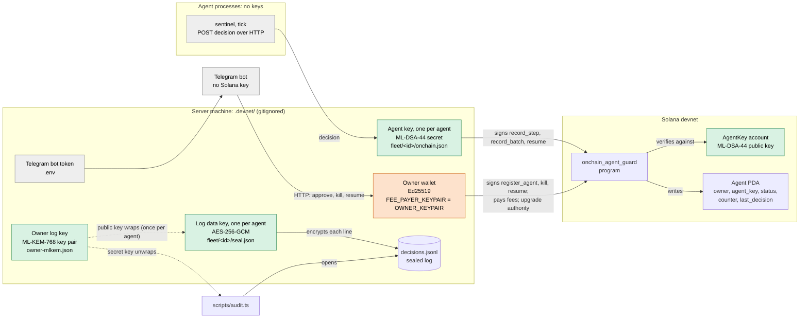

# Keys: where each one lives and what it signs

The system uses five secrets. Two are post-quantum and three are classical. The agent's decision history rests only on
the post-quantum ones.

| Key | Algorithm | Lives in | Signs / opens | Survives Q-day |
| --- | --- | --- | --- | --- |
| **Agent key**, one per agent | ML-DSA-44 | secret: server, `.devnet/fleet/<id>/onchain.json`; public: on-chain `AgentKey` account | `record_step`, `record_batch`, `resume` | yes |
| **Owner wallet** | Ed25519 | server, `FEE_PAYER_KEYPAIR` = `OWNER_KEYPAIR` (one file on devnet) | `register_agent`, `kill`, `resume`; pays every fee; upgrades the program | no |
| **Owner log key** | ML-KEM-768 | `.devnet/owner-mlkem.json` (`OWNER_MLKEM_FILE`) | its public key seals each agent's log key; its secret key opens them for the audit | yes |
| **Log data key**, one per agent | AES-256-GCM | `.devnet/fleet/<id>/seal.json` | encrypts every line of `decisions.jsonl` | yes |
| **Telegram bot token** | not a key pair | `.env`, `TELEGRAM_BOT_TOKEN` | controls the owner's bot | n/a |

Agent processes (`agents/`) hold no keys. They send decisions to the server over HTTP, and the server signs.

## Diagram

Green is post-quantum, orange is Ed25519, and grey holds no cryptographic key.

## The keys one by one

### Agent key: ML-DSA-44, one per agent

- **Created** by `bun scripts/agent.ts register`, which `scripts/setup.ts` runs once per agent. The register file
  (`.devnet/agents/<id>.json` from setup, `.devnet/agent.json` from the CLI) is then copied by `scripts/fleet.ts import`
  into `.devnet/fleet/<id>/onchain.json`, which the server reads. Both files hold the secret key, and no other copy
  exists. Lose both and the agent can never record a step or resume again.
- **Public key** is on-chain in the agent's `AgentKey` account (20,552 B, already in the form the verifier uses). It is
  written once by `register_agent` and read by every signed instruction (decision 002).
- **Signs** a message the program builds itself: `tag ‖ agent address ‖ next counter ‖ payload`, with FIPS 204 context
  `onchain-agent-guard:v1`. Tag 1 is `record_step` (payload: the decision's SHA-256), tag 2 is `resume` (no payload),
  and tag 3 is `record_batch` (payload: Merkle root and size, decision 007). Because the counter is in the message, a
  signature is accepted once.
- **Signed by** the server (`OnchainGuard`). The agent process never sees the key.

### Owner wallet: Ed25519

- **One file, three roles on devnet.** `.env.example` points both `FEE_PAYER_KEYPAIR` and `OWNER_KEYPAIR` at
  `.devnet/payer.json`. On the demo machine both point at `spikes/falcon-noble-compat/.devnet/payer.json`
  (`ftbM4rfE…`), which `onchain/deploy-devnet.sh` also deploys with, so it is the program's **upgrade authority** too.
- **As fee payer** it signs every transaction so the transaction can pay its fee. The program does not check who paid,
  so this signature authorizes nothing.
- **As owner** it signs `register_agent`, which pays the rent; the owner's address is also part of the Agent PDA seed.
  It signs `kill` on its own: that is the emergency brake, which has to work from a plain wallet even when the server
  is down. It signs `resume`, but only together with the agent's ML-DSA-44 signature.
- **Signed by** the server, for kill and resume from the page and the Telegram bot, because neither has a wallet
  (decision 008). The scripts `agent.ts` and `setup.ts` also use it.

### Owner log key: ML-KEM-768

- **Created** once by `bun scripts/fleet.ts owner-key` (setup runs it).
- **Public key** is used by `fleet.ts import` and `seal`: each agent gets a fresh ML-KEM capsule, and HKDF-SHA256 turns
  the capsule's shared secret into the agent's log data key (decision 006).
- **Secret key** is used only by `scripts/audit.ts`, to unwrap each capsule and open the log without trusting the
  server's copy of the data key. The server never reads it while running, so it could be moved off the server after
  setup. On devnet it stays in `.devnet/`.
- **No backup means no audit.** A wrong key does not raise an error: every sealed line just fails to open, and the audit
  reports each one as `on-chain, but not in the log`.

### Log data key: AES-256-GCM, one per agent

- `seal.json` holds both the capsule (`kemCiphertext`) and the derived key (`dataKey`). The server reads `dataKey`
  because it must read its own log: the page, Sentinel's restart and approvals all depend on that.
- Each log line is encrypted with a random nonce, and the step counter is bound in as additional authenticated data. It
  protects a copy of `decisions.jsonl` on its own, but not a copy of the whole agent directory, and not a taken-over
  server.

### Telegram bot token

The token is not a cryptographic key, but anyone who holds it controls the bot. The bot only accepts button presses from
`TELEGRAM_OWNER_CHAT_ID` and holds no Solana key: its buttons call the server's HTTP API, and the server signs with the
owner wallet. That local API has no authentication of its own (decision 008, "Czego nie chroni").

### Keys with no lasting power

- **Key-account keypair** (Ed25519): `register` generates it, uses it to sign the `create_account` for the 20,552 B
  `AgentKey` account (a program cannot allocate more than 10 KiB through CPI), and then discards it. Only its address
  is kept, as `agentKey`.
- **Program keypair** (`onchain/.devnet/program-keypair.json`, Ed25519): it fixes the program address
  `BL6Fjh4p…` and signed the first deploy. Upgrades are signed by the upgrade authority, not by this keypair.

## Who must sign each instruction

| Instruction | Agent ML-DSA-44 | Owner Ed25519 | Fee payer Ed25519 |
| --- | --- | --- | --- |
| `register_agent` | (public key stored) | ✔ (pays rent) | |
| `record_step` | ✔ | | ✔ |
| `record_batch` | ✔ | | ✔ |
| `kill` | | ✔ | (owner pays) |
| `resume` | ✔ | ✔ | (owner pays) |
| program upgrade | | ✔ (upgrade authority) | |

## If every Ed25519 key were broken

A quantum attacker who can forge any Ed25519 signature:

- **Cannot** forge, reorder or replay a step, a batch or a resume, because each one needs the agent's ML-DSA-44
  signature, which the program verifies. The recorded decision history stands.
- **Cannot** read a stolen copy of `decisions.jsonl`, which is AES-256 under a key wrapped with ML-KEM-768.
- **Can** `kill` an agent. That is deliberate: an attacker can stop an agent but cannot resume it.
- **Can** `register_agent` new agents under the owner's address. Existing agents are not affected. The fix is an
  owner ML-DSA-44 key (decision 004, next steps).
- **Can upgrade the program** while it is upgradeable, and replace the verifier. This is the largest gap on devnet:
  the upgrade authority is the same wallet that pays fees on the server. Decision 002 closes it by deploying the
  version shown as quantum-safe as immutable.

The rationale, and why there is no DMS seed proof, is in [decision 004](decisions/004-bez-dms-ochrona-pq-bez-dowodu-seeda.md).
