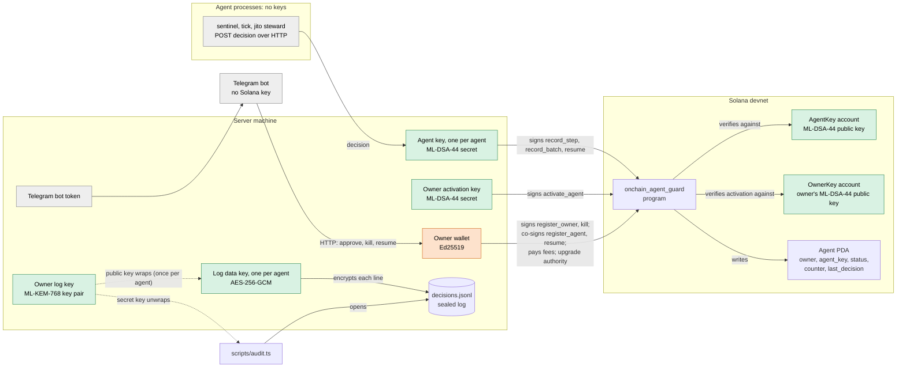

# Keys: who holds each one and what it signs

The system uses six secrets. Three are post-quantum and three are classical. The agent's decision history and the start
of every new agent rest only on the post-quantum ones.

| Key | Algorithm | Held by | Signs / opens | Survives Q-day |
| --- | --- | --- | --- | --- |
| **Agent key**, one per agent | ML-DSA-44 | secret: the server; public: on-chain `AgentKey` account | `record_step`, `record_batch`, `resume` | yes |
| **Owner activation key** | ML-DSA-44 | secret: the server; public: on-chain `OwnerKey` account | `activate_agent` | yes |
| **Owner wallet** | Ed25519 | the server (one wallet on devnet) | `register_owner`, `kill`; pays every fee; upgrades the program | no |
| **Owner log key** | ML-KEM-768 | the server | its public key seals each agent's log key; its secret key opens them for the audit | yes |
| **Log data key**, one per agent | AES-256-GCM | the server | encrypts every line of `decisions.jsonl` | yes |
| **Telegram bot token** | not a key pair | the bot | controls the owner's bot | n/a |

Agent processes (`agents/`) hold no keys. They send decisions to the server over HTTP, and the server signs. The files
each key is kept in are listed at the end, in [Files](#files).

## Diagram

Green is post-quantum, orange is Ed25519, and grey holds no cryptographic key.

## The keys one by one

### Agent key: ML-DSA-44, one per agent

- **Created** by `bun scripts/agent.ts register`, which `scripts/setup.ts` runs once per agent, and copied into the
  fleet by `scripts/fleet.ts import`. The register file and the fleet's copy both hold the secret key, and no other
  copy exists. Lose both and the agent can never record a step or resume again.
- **Public key** is on-chain in the agent's `AgentKey` account (20,552 B, already in the form the verifier uses). It is
  written once by `register_agent` and read by every signed instruction (decision 002).
- **Signs** a message the program builds itself: `tag ‖ agent address ‖ next counter ‖ payload`, with FIPS 204 context
  `onchain-agent-guard:v1`. Tag 1 is `record_step` (payload: the decision's SHA-256), tag 2 is `resume` (no payload),
  and tag 3 is `record_batch` (payload: Merkle root and size, decision 007). Because the counter is in the message, a
  signature is accepted once.
- **Signed by** the server (`OnchainGuard`). The agent process never sees the key.

### Owner activation key: ML-DSA-44

- **Created** once per owner wallet by `bun scripts/agent.ts register-owner`, which `scripts/setup.ts` runs. The file is
  written before the transaction is sent and is never overwritten.
- **Public key** is on-chain in the owner's `OwnerKey` account (20,552 B, prepared for the verifier), whose address the
  PDA `OwnerRecord` (`["owner", owner]`) holds. `OwnerRecord` is created with `init`, so a wallet's key cannot be
  registered twice or swapped (decision 005).
- **Signs** `activate_agent`: `tag 4 ‖ agent address ‖ counter 0`, with the same FIPS 204 context. `register_agent`
  leaves a new agent `Pending`, and the program refuses its steps until this signature makes it `Active`.
- **Signed by** the server, right after `register_agent`, because no wallet signs ML-DSA yet and on devnet the owner is
  the server's wallet anyway.
- **No backup means no new agents.** The key cannot be registered again for the same wallet, so without the file that
  wallet can activate no agent; it would take a new owner wallet. Agents already active keep working.

### Owner wallet: Ed25519

- **One wallet, three roles on devnet.** The fee payer and the owner are the same key pair, and the program was
  deployed with it too, so it is also the program's **upgrade authority**.
- **As fee payer** it signs every transaction so the transaction can pay its fee. The program does not check who paid,
  so this signature authorizes nothing.
- **As owner** it signs `register_owner` once, and `register_agent`, which pays the rent and creates the agent `Pending`;
  the owner's address is also part of the Agent PDA seed. Activation does not need it.
  It signs `kill` on its own: that is the emergency brake, which has to work from a plain wallet even when the server
  is down. It signs `resume`, but only together with the agent's ML-DSA-44 signature.
- **Signed by** the server, for kill and resume from the page and the Telegram bot, because neither has a wallet
  (decision 008). The scripts `agent.ts` and `setup.ts` also use it.

### Owner log key: ML-KEM-768

- **Created** once by `bun scripts/fleet.ts owner-key` (setup runs it).
- **Public key** is used by `fleet.ts import` and `seal`: each agent gets a fresh ML-KEM capsule, and HKDF-SHA256 turns
  the capsule's shared secret into the agent's log data key (decision 006).
- **Secret key** is used only by `scripts/audit.ts`, to unwrap each capsule and open the log without trusting the
  server's copy of the data key. The server never reads it while running, so it could be moved off the server after
  setup. On devnet it stays on the server.
- **No backup means no audit.** A wrong key does not raise an error: every sealed line just fails to open, and the audit
  reports each one as `on-chain, but not in the log`.

### Log data key: AES-256-GCM, one per agent

- The agent's seal file holds both the capsule (`kemCiphertext`) and the derived key (`dataKey`). The server reads `dataKey`
  because it must read its own log: the page, Sentinel's restart and approvals all depend on that.
- Each log line is encrypted with a random nonce, and the step counter is bound in as additional authenticated data. It
  protects a copy of `decisions.jsonl` on its own, but not a copy of the whole agent directory, and not a taken-over
  server.

### Telegram bot token

The token is not a cryptographic key, but anyone who holds it controls the bot. The bot only accepts button presses from
`TELEGRAM_OWNER_CHAT_ID` and holds no Solana key: its buttons call the server's HTTP API, and the server signs with the
owner wallet. That local API has no authentication of its own (decision 008, "Czego nie chroni").

### Keys with no lasting power

- **Key-account keypair** (Ed25519): `register` generates it, uses it to sign the `create_account` for the 20,552 B
  `AgentKey` account (a program cannot allocate more than 10 KiB through CPI), and then discards it. Only its address
  is kept, as `agentKey`.
- **Program keypair** (Ed25519): it fixes the program address
  `BL6Fjh4p…` and signed the first deploy. Upgrades are signed by the upgrade authority, not by this keypair.

## Who must sign each instruction

| Instruction | Agent ML-DSA-44 | Owner ML-DSA-44 | Owner Ed25519 | Fee payer Ed25519 |
| --- | --- | --- | --- | --- |
| `register_owner` | | (public key stored) | ✔ (pays rent, once per wallet) | |
| `register_agent` | (public key stored) | | ✔ (pays rent; agent starts `Pending`) | |
| `activate_agent` | | ✔ | | ✔ |
| `record_step` | ✔ | | | ✔ |
| `record_batch` | ✔ | | | ✔ |
| `kill` | | | ✔ | (owner pays) |
| `resume` | ✔ | | ✔ | (owner pays) |
| program upgrade | | | ✔ (upgrade authority) | |

## If every Ed25519 key were broken

This assumes the program is immutable, as decision 002 requires of the version shown as quantum-safe. The devnet deploy
is still upgradeable by the owner wallet for development; that authority is removed in the immutable deploy.

A quantum attacker who can forge any Ed25519 signature:

- **Cannot** forge, reorder or replay a step, a batch or a resume, because each one needs the agent's ML-DSA-44
  signature, which the program verifies. The recorded decision history stands.
- **Cannot** read a stolen copy of `decisions.jsonl`, which is AES-256 under a key wrapped with ML-KEM-768.
- **Cannot** start a fake agent under the owner's address. It can still send `register_agent`, but the agent stays
  `Pending` and every step is refused until the owner's ML-DSA-44 key signs `activate_agent`. This closes the gap that
  `register_agent` had while it took only the owner's Ed25519 signature (decision 005).
- **Can** `kill` an agent. That is deliberate: an attacker can stop an agent but cannot resume it.

Two limits remain. The first `register_owner` for a wallet decides its key, so it has to happen before Q-day; after
that a forged Ed25519 signature cannot replace it. Agents registered before the program learned activation stay
`Active` without it; `bun scripts/setup.ts --reregister` replaces them with new, activated agents.

The rationale, and why there is no DMS seed proof, is in [decision 004](decisions/004-bez-dms-ochrona-pq-bez-dowodu-seeda.md).

## Files

Paths are relative to the repo root. `.devnet/` and `.env` are gitignored.

| Key | File | Setting in `.env` |
| --- | --- | --- |
| Agent key | `.devnet/fleet/<id>/onchain.json`, read by the server; the register file `.devnet/agents/<id>.json` (setup) or `.devnet/agent.json` (CLI) | |
| Owner activation key | `.devnet/owner-mldsa.json` | `OWNER_MLDSA_FILE` |
| Owner wallet | `.devnet/payer.json` by default | `FEE_PAYER_KEYPAIR`, `OWNER_KEYPAIR` |
| Owner log key | `.devnet/owner-mlkem.json` | `OWNER_MLKEM_FILE` |
| Log data key | `.devnet/fleet/<id>/seal.json` | |
| E2E test fleet keys | `.devnet/e2e-fleet/<id>/` (`onchain.json`, `seal.json`), register files in `.devnet/e2e-agents/<id>.json` (`setup --e2e`) | `FLEET_DIR` (the tests set it) |
| Telegram bot token | `.env` | `TELEGRAM_BOT_TOKEN` |
| Program keypair | `onchain/.devnet/program-keypair.json` | |

On the demo machine both wallet settings point at `spikes/falcon-noble-compat/.devnet/payer.json` (`ftbM4rfE…`), the
wallet `onchain/deploy-devnet.sh` deployed with.
